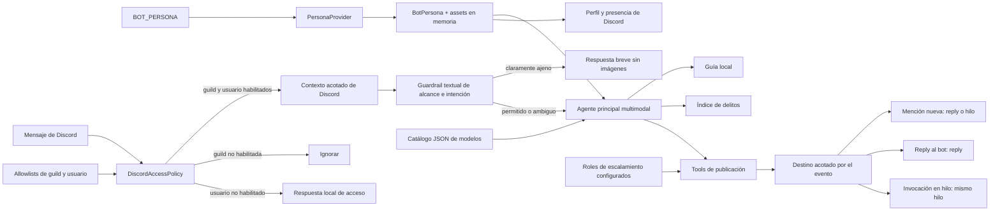

# Arquitectura del MVP

## Flujo

`SnowflakeAllowlist` centraliza el parseo de `DISCORD_GUILD_IDS`, `REPORT_CHANNEL_IDS`,
`AUTHORIZED_USER_IDS` y `ROLE_REQUEST_ALLOWED_CHANNEL_IDS`: ausente, vacío o `*` abre la colección;
cualquier CSV la restringe.
`ALLOWED_CHANNEL_IDS` y `REVIEW_CHANNEL_IDS` se conservan como aliases de migración para
`REPORT_CHANNEL_IDS`.

`DiscordAccessPolicy` es el único preprocesador del listener y se ejecuta antes de descargar contexto
o llamar a OpenAI. Valida guild, autor humano, activación por mención o respuesta directa al bot y
usuario, en ese orden. No limita canales: dentro de una guild autorizada, una mención puede iniciar
una conversación desde cualquier canal visible. Si Discord no incluyó el mensaje referenciado,
resuelve solo esa referencia antes de decidir; una respuesta a cualquier otra persona se ignora.

La colección `REPORT_CHANNEL_IDS` queda separada del acceso conversacional. El adaptador la usa para
consultas deterministas de reportes y para `/ayuda`; al presentarla, resuelve cada ID en la guild
actual y solo muestra canales de texto visibles para el bot y el solicitante. Los IDs de otras guilds,
eliminados o inaccesibles se omiten y se registran sin bloquear la conversación.
`/verguenza` y `/honor` conservan ese origen en el resultado y construyen una sección independiente por canal,
en lugar de mezclar estaciones en un único ranking. La agregación conserva por separado los
expedientes sin reacción y aquellos marcados `⏳`, para que la presentación no confunda ausencia de
revisión con una revisión activa.

Una vez superada la política local, `request_scope` clasifica alcance e intención usando solo el
texto de la solicitud actual y señales compactas de contexto. Es bloqueante
(`run_in_parallel=False`), usa el modelo soportado con `reasoning=none` y no recibe imágenes. Solo
bloquea solicitudes inequívocamente ajenas; saludos, peticiones ambiguas y conversaciones vinculadas
al expediente continúan hacia el agente principal.

Las tools de publicación reciben un `ReviewTarget` derivado del evento aprobado y no aceptan guilds
o canales arbitrarios. `set_message_reaction` recibe un ID, pero el adaptador solo lo resuelve como
raíz, trigger o mensaje del canal/hilo activo. Por ello sus reacciones, hilos y mensajes quedan
acotados a la conversación que atravesó la política. El mensaje raíz es la unidad de exclusión mutua: dos
invocaciones simultáneas para el mismo reporte no generan dos runs.

Ante una revisión inconclusa o una falla técnica, el adaptador resuelve
`REVIEW_ESCALATION_ROLE_IDS` dentro de la guild y menciona una sola vez únicamente los roles que
todavía existen. La mención y su `AllowedMentions` se construyen de forma determinista; el modelo no
recibe IDs de roles ni decide a quién derivar. El alias legado `MANUAL_REVIEW_ROLE_ID` sigue
admitiendo una configuración de un solo rol.

La política también conserva si la activación fue una mención o una respuesta directa al bot. Ante
una mención nueva en un canal padre, el modelo puede escoger únicamente `reply` o `thread`: usa reply
para una respuesta breve y visible, e hilo cuando espera continuidad o contenido extenso. La primera
publicación conversacional fija la ruta durante toda la ejecución. Un reply al bot fuerza
`inline_reply`, dentro de un hilo siempre se reutiliza ese hilo y `publish_review` lleva una revisión
nueva al hilo. El hilo se crea de forma perezosa, por lo que un guardrail bloqueado no deja hilos
vacíos. Los IDs de mensajes visibles se incluyen para consultas y reacciones acotadas, pero el
modelo no puede escoger una guild ni un canal de publicación.

## Capas

- `domain`: modelos Pydantic y enums que definen el contrato de revisión.
- `config`: entorno, allowlists, proveedor de personas y catálogos JSON validados.
- `knowledge`: guía versionada e índice del JSON del PCU, cargados y validados al iniciar.
- `application`: prompt, tools, contexto del runner, errores, tracing y orquestación.
- `infrastructure/discord`: política previa, reconstrucción de hilos, embeds, reacciones y comandos.
- `role_requests`: modelos, codec, política, servicio, modales y vistas persistentes del subsistema
  determinista de solicitudes de roles; no depende del runner ni de `infrastructure/discord`.

Los comandos personales `/mis-reportes` y `/mi-resumen` siguen una ruta determinista separada
del runner. Leen de forma acotada los canales de revisión visibles, atribuyen publicaciones raíz al
usuario que invoca el comando y derivan el estado solo de las reacciones creadas por esta cuenta del
bot. Sus respuestas son efímeras y nunca incorporan información de otros miembros.

Los comandos generales `/guia`, `/cargos` y `/faq` también evitan el runner. Presentan la
guía y el catálogo versionados mediante vistas efímeras ligadas al usuario: los selectores y botones
editan el mismo mensaje, mientras que la búsqueda de cargos resuelve localmente código, título,
categoría y descripción con un límite acotado de resultados.

`/verguenza` comparte el finder determinista: abre un modal privado para elegir mes actual o los
últimos 7, 30 o 90 días y después publica un top 10 visible para el canal. Filtra primero todo reporte
que ya tenga ✅ y agrupa los estados restantes por autor dentro del periodo. La consulta respeta la
allowlist de guilds y los permisos efectivos de lectura del solicitante, pero deliberadamente no
aplica la allowlist de usuarios ni los roles de supervisión.

`/honor` reutiliza el mismo snapshot y los mismos periodos, pero conserva únicamente autores con al
menos un reporte aprobado. El orden usa cantidad de aprobaciones, porcentaje y volumen como
desempates; el total y la tasa mantienen todos los estados del autor para conservar el contexto.

El contrato funcional completo de los comandos está documentado en [Comandos de Discord](COMMANDS.md).

Los comandos `/pendientes` y `/ranking` reutilizan el mismo finder acotado, pero permiten
consultar autores distintos al solicitante. Una política de roles independiente se construye desde
`SUPERVISOR_ROLE_IDS` y se aplica antes de cualquier lectura; esta frontera permite reemplazar la
configuración por guild desde una base de datos sin modificar las vistas ni las agregaciones.
El finder reutiliza esa política para reconocer estados manuales: confía en las reacciones del bot y
en las de miembros que posean un rol autorizado, ignorando las del resto.
- `bootstrap`: composición de dependencias y healthcheck.

## Despliegue en Railway

`railway.json` fija una sola réplica siempre activa, construcción mediante el `Dockerfile`,
healthcheck `/health`, reinicio permanente y una ventana de 30 segundos entre `SIGTERM` y `SIGKILL`.
El runtime escucha primero el `PORT` inyectado por Railway y conserva `HEALTH_PORT` como fallback
local. La señal de apagado cierra Discord, el servidor de salud y los traces antes de terminar.

La fuente de producción es la rama `main`. GitHub Actions valida lint, tipos, tests y la imagen
Docker en cada push; Railway debe mantener **Wait for CI** habilitado para desplegar únicamente
revisiones que terminen esos checks correctamente. Las variables y secretos viven en Railway, no en
el repositorio, y la identidad continúa seleccionándose exclusivamente mediante `BOT_PERSONA`.

## Solicitudes de roles

`ROLE_REQUEST_REVIEWER_ROLE_IDS` actúa como feature flag y frontera de autorización: vacío evita
registrar `/solicitar-roles`, `/info-roles` y su vista persistente. Cuando está habilitado,
`ROLE_REQUEST_ALLOWED_ROLE_IDS` es obligatorio y forma el catálogo ordenado que el adaptador resuelve
contra la guild actual. El comando solo aplica la allowlist de guilds y la allowlist independiente de
canales; no reutiliza `AUTHORIZED_USER_IDS` ni las políticas del agente.

Los selectores de creación son `StringSelect` deterministas. El adaptador descarta roles inexistentes
o protegidos, separa altas de bajas según el estado actual del miembro y divide catálogos de más de
25 elementos sin superar los cinco campos del modal. Los valores recibidos del cliente se vuelven a
resolver y validar contra el catálogo antes de publicar.

No existe repositorio ni base de datos. El adaptador publica un embed provisional, obtiene su ID y lo
edita con el marcador visible `Solicitud <message_id>` y tres `custom_id` internos y versionados. El codec
valida autor del bot, guild, canal, footer, autor lógico, orden de campos, menciones de roles y estado
de los componentes. Por eso una vista genérica registrada al arrancar puede resolver una solicitud
después de reiniciar usando únicamente `interaction.message.id` y el mensaje vuelto a descargar.

Cada decisión usa un lock por ID y revalida supervisor, miembro, roles protegidos y jerarquía dentro
del lock. La aprobación completa o parcial calcula el conjunto final desde los roles actuales y lo
aplica mediante una sola edición del miembro, considerando satisfechos los cambios hechos
manualmente. La resolución terminal edita el mismo embed y deshabilita todos los componentes. Un
error HTTP transitorio deja el mensaje pendiente; la ausencia definitiva del miembro, de un rol o de
una jerarquía válida lo cierra como fallido.

## Personas

`BOT_PERSONA` es obligatorio y selecciona un perfil empaquetado. `PackagedPersonaProvider` valida el
JSON y carga su avatar antes de construir Discord o el runner. El resultado inmutable se comparte
en memoria; prompt, embeds, mensajes deterministas, presencia, trazas y perfil no vuelven a leer el
entorno ni los archivos.

`PersonaProvider` separa el contrato de su almacenamiento. Una implementación futura puede obtener
el mismo `BotPersona` y assets desde una base de datos sin cambiar los consumidores. En el MVP
existen `walter_vigil` y `roy_velazco`; cambiar la selección requiere reiniciar el proceso.

La personalidad separa la voz de conversación natural de la voz breve del resumen superior de una
revisión. El prompt y el esquema de `publish_review` reservan esos registros para sus contextos; los
hallazgos, cargos, recomendaciones y motivo de derivación permanecen técnicos,
formales y neutrales. Cada registro incluye few-shots tipados, validados y limitados para orientar la
voz sin cargar una conversación completa. El renderer muestra el resumen y los campos técnicos en
secciones distintas.

Cada perfil también declara `messages.access`, `messages.failures`, `messages.help` y
`messages.interface`. Estos registros alimentan el texto local que debe conservar la voz del
personaje: redirecciones, autorizaciones, rechazos de alcance, fallas operativas seguras, ayuda,
descripciones de comandos, selectores, modales, botones, navegación, estados vacíos, embeds y
ownership de interfaces privadas. Los campos con interpolación usan un conjunto exacto de
placeholders validado al arrancar; no se permite acceder a atributos ni aplicar formatos dinámicos.
Los datos y nombres que provienen del catálogo o la guía, además de los hallazgos técnicos de una
revisión, permanecen en la capa funcional para no contaminar información objetiva con la
personalidad.

En `on_ready`, `DiscordProfileSynchronizer` aplica username y avatar desde la persona, el banner
verde musgo global de LSSD y la biografía por guild. Los campos globales se envían por separado para
que el cooldown de uno no bloquee los demás. Un lock evita duplicados durante reconexiones; un error
conserva el bot operativo y permite reintentar solo el campo pendiente en el siguiente `on_ready`.
El nickname es opcional y `null` significa que no se administra por guild.

## Herramientas del agente

- `get_report_guide(sections)`: devuelve solo las secciones solicitadas.
- `list_charge_index(category_ids, query, fields, match_mode, fuzzy, limit)`: sin filtros lista
  categorías; con filtros busca sobre código, título, tipo, categoría o descripción y retorna IDs y
  resultados compactos. Permite exigir todos/cualquiera de los términos y tolerar typos de forma
  explícita; no acepta expresiones regulares.
- `get_charge_details(charge_ids)`: devuelve hasta diez delitos por ID único.
- `list_guild_roles(query, role_ids, include_managed, fields, sort_by, sort_direction, limit,
  cursor)`: descubre roles de la guild actual, admite proyección y paginación opaca y retorna IDs
  utilizables por los filtros de miembros.
- `find_guild_members(filters, fields, sort_by, sort_direction, limit, cursor)`: combina búsqueda por
  nombre, IDs, roles con semántica any/all/none, bots y fechas de ingreso. La guild se deriva del
  mensaje y cada página contiene como máximo 25 miembros.
- `find_channel_members(channel_id, membership, message_limit, filters, fields, sort_by,
  sort_direction, limit, cursor)`: busca quién puede ver un canal, quién participó recientemente,
  quién pertenece a un hilo o quién está conectado a voz, siempre verificando guild y permisos.
- `get_guild_members(user_ids, fields)`: consulta uno a diez miembros exclusivamente dentro de la
  guild de la conversación. Proyecta los campos solicitados y usa nombre visible y roles por
  defecto; no admite un `guild_id` y amplía IDs concretos descubiertos previamente.
- `get_messages(channel_id, message_id, direction, limit, author_ids, author_type, has_attachments,
  fields)`: lee hasta veinte mensajes de un canal o hilo elegido dentro de la guild actual. Admite
  lectura exacta, anterior, posterior, alrededor de un ancla o de los mensajes más recientes, con
  filtros y proyección; verifica que el solicitante pueda ver el historial antes de leerlo.
- `get_message_attachments(message_id, channel_id, attachment_ids)`: recupera imágenes o documentos
  de un mensaje legible como outputs multimodales nativos. No acepta guilds ni URLs, omite adjuntos
  ya cargados y aplica los límites acumulados de cantidad y tamaño de la ejecución.
- `send_message(content, response_route)`: mensaje intermedio reutilizable con Markdown de Discord,
  enlaces y emojis moderados; ejecuta el envío de inmediato, pero permite que el agente continúe.
- `finish_interaction(content, response_route)`: envía la respuesta conversacional final y termina
  explícitamente la ejecución; también sirve para devolver el turno al usuario mediante una
  pregunta aclaratoria. `response_route` solo admite `reply` o `thread` y no puede vencer una ruta
ya fijada por un reply, un hilo existente o un envío anterior.
- `set_message_reaction(message_id, emoji)`: aplica inmediatamente una reacción a un mensaje de la
  conversación activa. Para `⏳`, `✅`, `❌` y `⚠️` reemplaza solamente los marcadores de estado
  puestos por el bot; cualquier otro emoji es aditivo y nunca elimina reacciones humanas.
- `publish_review(publication)`: tool terminal que ejecuta inmediatamente el veredicto en Discord.

`parallel_tool_calls` permanece deshabilitado para mantener un orden determinista en efectos
externos. Solo `finish_interaction` y `publish_review` detienen el runner; `send_message` y
`set_message_reaction` pueden ejecutarse antes del cierre. El agente conserva `tool_choice=required` durante todas las
rondas: después de consultar conocimiento o enviar un avance debe escoger una tool siguiente y no
puede finalizar con texto suelto o un mensaje vacío. Las tools locales de conocimiento pueden usarse
también para responder dudas.

El contrato de `ReviewPublication` trata la comparación de cargos como diagnóstico informativo.
`unsupported`, `uncertain` y `not_found` pueden convivir con `approved`, ya que el cargo registrado es
inmutable. `corrections_required` exige al menos un hallazgo `required` sobre una deficiencia
corregible del reporte y nunca puede justificarse únicamente por el cargo.

Antes de esa comparación, el prompt y la guía tratan `Búsqueda de arrestos` como un historial del
personaje. El agente valida el nombre del título y selecciona solo filas de la fecha narrada o de una
fecha inmediatamente próxima compatible con la tramitación; diferencias de horas y cruces de
medianoche no son contradicciones por sí solos. Las filas antiguas se excluyen antes de evaluar los
cargos.

`ReviewPublication.review_scope` distingue `full`, `narrative`, `charges` y `targeted`; este último
requiere un `focus` explícito. El veredicto se interpreta únicamente dentro de ese alcance. Una
publicación parcial muestra el scope en su título, retira solo la reacción transitoria `⏳` y no
añade `✅`, `❌` o `⚠️`, no archiva el hilo y no altera el estado que consumen las analíticas. Solo
una revisión `full` puede marcar el estado terminal del expediente.

## Lifecycle del agente

`ReviewLifecycleHooks` recibe `on_agent_start` después del guardrail bloqueante. Si el preflight
clasificó `review` y existe material revisable, añade `⏳` una sola vez; las conversaciones y las
revisiones sin antecedentes no reciben esa marca. `on_agent_end` registra en contexto el cierre
exitoso. Errores y timeouts permanecen bajo el `try/except` del servicio, porque el hook de término no
se ejecuta cuando el agente no produce una salida final. Así se evita exponer `begin_review` y la
ronda adicional de modelo que requería una tool no terminal.

## Presencia global

`ReviewPresence` asigna una sesión a cada interacción y publica la actividad de mayor prioridad:
`review > knowledge > conversation > idle`. Una sesión solo puede promocionarse, por lo que una
búsqueda de conocimiento no degrada una revisión. Al terminar la actividad prioritaria se recupera
la siguiente que siga activa; el último cierre vuelve a reposo. Solo se llama a Discord cuando cambia
el modo global. `on_ready` resincroniza tras una reconexión y cualquier fallo cosmético se registra
sin interrumpir el expediente. Los cuatro textos provienen de la persona cargada.

## Resolución del modelo y costos

El entorno selecciona únicamente `OPENAI_MODEL` y `OPENAI_REASONING_EFFORT`. Al arrancar, el runtime
carga `config/data/models.json`, lo valida con Pydantic y rechaza modelos o efforts no soportados. El
catálogo aporta detalle de imagen, verbosity, límite de salida, service tier y tarifas.

El costo se calcula desde `Usage` del Agents SDK. Se conservan los contadores crudos y cada llamada
se tarifa de forma independiente para seleccionar correctamente el tramo de contexto. Las escrituras
de caché tienen su propia tarifa; `reasoning_tokens` es un subconjunto de `output_tokens` y no se suma
por segunda vez. El uso del guardrail se agrega al wrapper del run principal, por lo que sus tokens y
costo quedan incluidos en el total operativo de la solicitud. Si una validación local falla después
de que el Runner terminó, el log conserva el uso completo del resultado en vez de degradarlo al uso
parcial del guardrail.

## Contexto de conversación

No se usan sesiones ni persistencia del SDK. Cada mención reconstruye un input autocontenido con:

- reporte raíz;
- mensajes recientes del hilo en orden cronológico;
- referencias de respuesta y extractos acotados;
- indicador de mensaje editado;
- solicitud actual;
- nombre visible del solicitante y hasta ocho nombres de roles no administrados por participante,
  ordenados por jerarquía y presentados en líneas compactas, sin IDs de roles;
- un registro acotado `user_id=nombre` de participantes visibles para alimentar consultas explícitas
  de metadata sin repetir IDs en cada mensaje;
- imágenes y documentos del mensaje actual;
- adjuntos del reporte raíz y una cantidad acotada de imágenes y archivos históricos recientes.

Cada mensaje se reconstruye como un turno nativo. Solo los mensajes producidos por la cuenta
autenticada del bot usan el rol `assistant`; miembros, webhooks y otros bots permanecen como `user`.
Los adjuntos conservan el turno donde se publicaron y una versión documental incluida en la
solicitud actual prevalece sobre versiones anteriores del mismo material.
Cada turno indica cuántos adjuntos del mensaje fueron cargados inicialmente. Si el límite histórico
dejó alguno fuera, el prompt exige usar `get_message_attachments` cuando ese material pueda cambiar
la respuesta; una omisión por presupuesto de contexto no puede interpretarse como evidencia ausente.

En un hilo, primero se intenta recuperar el mensaje que lo originó. Si fue eliminado o el hilo no
nació desde un mensaje, se usa el mensaje visible más antiguo; si tampoco existe, la propia mención
actual funciona como raíz. El contexto y todas las respuestas permanecen en el mismo hilo.

Fuera de hilos se incluyen, por defecto, hasta cinco mensajes de texto inmediatamente anteriores
del mismo canal. `CHANNEL_CONTEXT_MAX_MESSAGES` permite ajustar el límite o desactivarlo con `0`.
Estos turnos se etiquetan como contexto ambiental para resolver referencias conversacionales, no se
consideran parte del expediente actual y sus adjuntos no se envían al runner. El modelo recibe solo
una descripción compacta con cantidad, tipo y nombres de archivo, sin contenido ni URLs.

Las tools `list_guild_roles`, `find_guild_members` y `find_channel_members` usan siempre
`ReviewCase.guild_id`; no incluyen un argumento de guild. El directorio completa la caché de Pycord
con `Server Members Intent`, aplica filtros antes de proyectar y limita cada página a 25 resultados.
Los cursores incluyen versión, tipo de consulta y huella de filtros, por lo que no pueden reutilizarse
para cambiar silenciosamente el alcance. Un canal seleccionado se resuelve exclusivamente desde la
guild activa, exige acceso del solicitante y rechaza hilos privados ajenos al contexto.

`get_guild_members` conserva el camino eficiente para hasta diez IDs concretos: consulta primero la
caché y recurre a `fetch_member` solo ante misses. Los roles de integración y `@everyone` se omiten de
las proyecciones de miembros para reducir ruido.

`get_messages` también queda fijada a `ReviewCase.guild_id`, pero permite al agente escoger un canal
o hilo, mensaje ancla y ventana. El adaptador verifica pertenencia a la guild, permisos de
`view_channel` y `read_message_history` del solicitante, y no permite saltar desde otro canal hacia
un hilo privado. Los adjuntos se describen sin URL ni contenido y el texto total de la respuesta se
acota antes de volver al modelo.

`get_message_attachments` reutiliza exactamente esa frontera de permisos, vuelve a obtener el
mensaje para usar URLs vigentes de Discord y entrega el contenido al SDK como `ToolOutputImage` o
`ToolOutputFileContent`. El modelo solo selecciona un mensaje, canal y hasta diez IDs de adjunto;
no puede suministrar una URL, cambiar de guild ni exceder los límites globales de la revisión. El
contexto de ejecución contabiliza lo que ya venía en el input para evitar cargarlo o cobrarlo dos
veces durante el mismo run.

`set_message_reaction` no reutiliza un destino entregado libremente por el modelo: el publisher
resuelve el ID contra el mensaje raíz, la solicitud actual o el canal/hilo de la conversación. Los
estados son idempotentes y mutuamente excluyentes únicamente para las reacciones propias del bot.

Los límites de mensajes, caracteres, imágenes, archivos y tamaño combinado se aplican antes del
runner. El reporte raíz y la solicitud actual se protegen al recortar; el resto conserva los
mensajes más recientes hasta `THREAD_CONTEXT_MAX_MESSAGES`. El input indica si el contexto quedó
`complete`, `truncated` o `unavailable` para evitar conclusiones excesivas.

## Extensión futura

`ReviewPublisher` aísla el runner de Discord y las fuentes locales no dependen del bot. Una futura
persistencia puede almacenar configuración, intentos, veredictos y threads sin cambiar el contrato
de `ReviewPublication`. Una API de PCU/OpenMP puede reemplazar `ChargeCatalog` mediante el mismo
interfaz de consulta; una tabla por guild/facción puede sustituir las variables de entorno.
