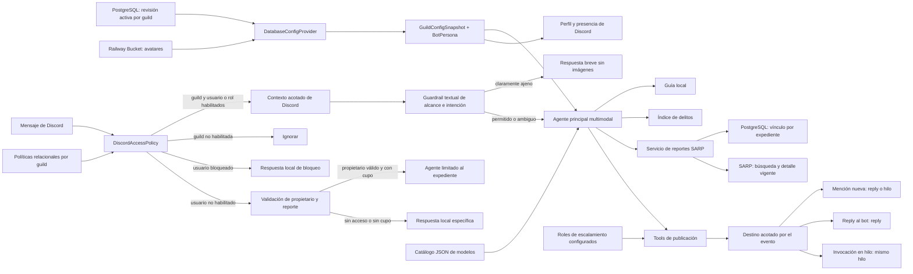

# Arquitectura del MVP

## Flujo

`DatabaseConfigProvider` reconstruye un snapshot Pydantic inmutable por guild. Cada interacción
conserva la misma revisión hasta terminar, aunque se publique otra concurrentemente. Las políticas
relacionales se convierten al contrato `SnowflakeAllowlist` existente en el borde del adaptador, por
lo que `open`, `restricted` y `disabled` no se reinterpretan dentro de Discord.

Los env legacy se leen solamente mediante `db import-env`; el runtime no vuelve a consultarlos. El
importador resuelve canales y roles contra Discord, los distribuye por guild y registra un checksum
idempotente antes del corte definitivo.

`DiscordAccessPolicy` es el único preprocesador del listener y se ejecuta antes de descargar contexto
o llamar a OpenAI. Valida guild, autor humano y activación por mención o respuesta directa al bot;
después aplica `agent_blocked_users` y finalmente el acceso positivo. La blacklist tiene precedencia
absoluta y las políticas `agent_users` y `agent_roles` se combinan como OR. No limita canales: dentro
de una guild autorizada, una mención puede iniciar
una conversación desde cualquier canal visible. Si Discord no incluyó el mensaje referenciado,
resuelve solo esa referencia antes de decidir; una respuesta a cualquier otra persona se ignora.

La colección `REPORT_CHANNEL_IDS` queda separada del acceso conversacional. El adaptador la usa para
consultas deterministas de reportes y `/info-reportes`; al presentarla, resuelve cada ID en la guild
actual y solo muestra canales de texto visibles para el bot y el solicitante. `/ayuda` no necesita
resolver canales: funciona como un índice estable hacia las guías especializadas. Los IDs de otras
guilds, eliminados o inaccesibles se omiten y se registran sin bloquear la conversación.
`/verguenza` y `/honor` conservan ese origen en el resultado y construyen una sección independiente por canal,
en lugar de mezclar estaciones en un único ranking. La agregación conserva por separado los
expedientes sin reacción y aquellos marcados `⏳`, para que la presentación no confunda ausencia de
revisión con una revisión activa.

Cuando `report_owner_access` está habilitado, esos canales explícitos forman además la frontera del
acceso limitado. El listener solo concede `report_owner` si el autor responde directamente a su
propio reporte o habla dentro del hilo cuyo ID coincide con el mensaje raíz. El root debe contener
`Nombre Apellido`, opcionalmente seguido de `- #NÚMERO`, y cuatro imágenes compatibles cuando la entrada ocurre en el canal
padre; la mención debe preceder el nombre cuando el propio reporte activa al bot. Dentro de un hilo
canónico no se exige formato ni material mínimo: la autoría y el anclaje al canal configurado son la
frontera determinista. No usa el fallback de hilos huérfanos para esta decisión. Antes del guardrail
reserva atómicamente una ronda en
`report_owner_agent_runs`; el trigger único evita ejecuciones duplicadas y un advisory lock impide
superar el máximo bajo concurrencia. Los fallos anteriores a esa reserva no consumen, mientras que
cualquier ejecución que ya puede alcanzar OpenAI queda contabilizada aunque falle después.

Una vez superada la política local, `request_scope` clasifica alcance e intención usando solo el
texto de la solicitud actual y señales compactas de contexto. Es bloqueante
(`run_in_parallel=False`), usa el modelo soportado con `reasoning=none` y no recibe imágenes. Solo
bloquea solicitudes inequívocamente ajenas; saludos, peticiones ambiguas y conversaciones vinculadas
al expediente continúan hacia el agente principal.

Las tools de publicación reciben un `ReviewTarget` derivado del evento aprobado y no aceptan guilds
o canales arbitrarios. `set_message_reaction` recibe un ID, pero el adaptador solo lo resuelve como
raíz, trigger o mensaje del canal/hilo activo. Por ello sus reacciones, hilos y mensajes quedan
acotados a la conversación que atravesó la política. El mensaje raíz es la unidad de exclusión mutua: dos
invocaciones simultáneas para el mismo reporte no generan dos runs.

Ante una revisión inconclusa o una falla técnica, el adaptador resuelve
`REVIEW_ESCALATION_ROLE_IDS` dentro de la guild y menciona una sola vez únicamente los roles que
todavía existen. La mención y su `AllowedMentions` se construyen de forma determinista; el modelo no
recibe IDs de roles ni decide a quién derivar. El alias legado `MANUAL_REVIEW_ROLE_ID` sigue
admitiendo una configuración de un solo rol.

La política también conserva si la activación fue una mención o una respuesta directa al bot. Ante
una mención nueva en un canal padre, el modelo puede escoger únicamente `reply` o `thread`: usa reply
para una respuesta breve y visible, e hilo cuando espera continuidad o contenido extenso. La primera
publicación conversacional fija la ruta durante toda la ejecución. Un reply al bot fuerza
`inline_reply`, dentro de un hilo siempre se reutiliza ese hilo y `publish_review` lleva una revisión
nueva al hilo. El hilo se crea de forma perezosa, por lo que un guardrail bloqueado no deja hilos
vacíos. Los IDs de mensajes visibles se incluyen para consultas y reacciones acotadas, pero el
modelo no puede escoger una guild ni un canal de publicación.

## Capas

- `domain`: modelos Pydantic y enums que definen el contrato de revisión.
- `config`: secretos de proceso, snapshots Pydantic y catálogos JSON validados.
- `knowledge`: guía versionada, índice del JSON del PCU y referencia acotada de códigos radiales,
  cargados y validados al iniciar.
- `application`: prompt, tools, contexto del runner, errores, tracing y orquestación.
- `report_owner_access`: repositorio transaccional y contratos del cupo permanente por expediente.
- `arrest_reports`: servicio de aplicación y repositorio de referencias entre un expediente de
  Discord y un arresto SARP; no almacena narrativa ni cargos.
- `infrastructure/discord`: política previa, reconstrucción de hilos, embeds, reacciones y comandos.
- `infrastructure/postgres`: cliente async, esquema SQLAlchemy, repositorios y caché dinámica.
- `infrastructure/storage`: contrato de objetos y adaptador S3 para Railway Bucket.
- `role_requests`: modelos, codec, política, servicio, modales y vistas persistentes del subsistema
  determinista de solicitudes de roles; no depende del runner ni de `infrastructure/discord`.
- `pagers`: modelos, repositorio PostgreSQL, servicio, modales, listados y controles persistentes
  del subsistema de avisos operativos; no depende del agente ni de OpenAI.
- `operational_profiles`: metadata reutilizable por guild y miembro, persistencia de callsigns,
  actualización privada, directorio agrupado y ayuda pública.
- `manual_quiz`: catálogo PostgreSQL validado, filtros por dificultad y tipo, rotación persistente
  por guild y combinación de filtros sin repeticiones hasta agotar cada conjunto, y sesiones públicas
  con vencimiento acotado en memoria
  temporales de práctica; no depende del runner, no usa OpenAI y no guarda resultados personales.
  La rotación conserva como máximo una entrada por pregunta del ciclo activo y elimina el ciclo
  anterior al comenzar el siguiente, por lo que no crea un historial creciente. Su seed SQL usa slugs
  estables por guild para cargar o actualizar en bloque las preguntas sin duplicarlas ni afectar
  catálogos ajenos.
- `forum_shortcuts`: catálogo público por guild, validado y versionado en PostgreSQL; renderiza un
  embed institucional público con secciones, enlaces y banner sin depender de personas, IA o SARP.
- `deployments`: contrato de webhooks Railway, inbox de eventos, outbox idempotente y renderer de
  changelog/alertas para Discord; no depende del runner ni de OpenAI.
- `ci_notifications`: receptor firmado de GitHub Actions, inbox/outbox PostgreSQL y renderer de
  alertas internas de CI; usa una política de canales independiente y no depende de OpenAI.
- `service_calls`: polling dinámico del endpoint de emergencias SARP, publicación segura en Discord
  y un cursor mínimo por guild/canal; no persiste el contenido de los llamados ni usa OpenAI.
- `stolen_vehicles`: consulta determinista y feed dinámico de denuncias SARP; comparte servicio entre
  el comando y el worker, guarda solo el último ID publicado por guild/canal y no usa OpenAI.
- `faction_status`: consulta agrupada y con caché corto del roster SARP configurado por guild; no
  persiste estados de conexión ni usa OpenAI.

Los comandos personales `/mis-reportes` y `/mi-resumen` siguen una ruta determinista separada
del runner. Leen de forma acotada los canales de revisión visibles, atribuyen publicaciones raíz al
usuario que invoca el comando y derivan el estado solo de las reacciones creadas por esta cuenta del
bot. Sus respuestas son efímeras y nunca incorporan información de otros miembros.

Los comandos generales `/guia`, `/cargos` y `/faq` también evitan el runner. Presentan la
guía y el catálogo versionados mediante vistas efímeras ligadas al usuario: los selectores y botones
editan el mismo mensaje, mientras que la búsqueda de cargos resuelve localmente código, título,
categoría y descripción con un límite acotado de resultados.

El subsistema `mdc` también es determinista, pero consulta datos operativos en vivo mediante el
cliente SARP compartido. Resuelve primero una coincidencia exacta y luego ejecuta en paralelo las
lecturas de perfil IC, posesiones, multas, órdenes y arrestos. Su modelo de dominio descarta IDs y
campos OOC antes de llegar al renderer de Discord; cada sección tolera fallos de forma independiente
y no se conserva en PostgreSQL.

Las consultas de reportes de arresto reutilizan `SarpClient`, pero quedan detrás de
`SarpArrestReportLookup`. El agente recibe tools tipadas y no conoce credenciales, facciones ni SQL.
Una búsqueda devuelve candidatos compactos y un detalle posterior recupera la narrativa y los cargos
actuales sin caché. En hilos de canales de reportes, el acceso completo puede reemplazar mediante
upsert la referencia `(guild_id, root_message_id)`. El acceso limitado no recibe herramientas de
búsqueda o vinculación: solo puede resolver esa clave exacta y descargar nuevamente el arresto.
Los límites por ejecución acotan reformulaciones y lecturas sin impedir el fallback a mensajes,
imágenes o archivos cuando la API no responde.

El subsistema `faction_status` consume el detalle interno agrupado de la facción configurada. Proyecta
únicamente nombre, conexión y estado de servicio, aplica `online && factionduty` para la vista en
servicio y comparte un caché corto por facción. El comando no conoce IDs de servidores ni facciones;
la relación vive en el snapshot dinámico de PostgreSQL.

`/verguenza` comparte el finder determinista: abre un modal privado para elegir mes actual o los
últimos 7, 30 o 90 días y después publica un top 10 visible para el canal. Filtra primero todo reporte
que ya tenga ✅ y agrupa los estados restantes por autor dentro del periodo. La consulta respeta la
allowlist de guilds, la política independiente `report_analytics_roles` y los permisos efectivos de
lectura del solicitante. No aplica la allowlist de usuarios ni concede por sí sola permisos de
supervisión.

`/honor` reutiliza el mismo snapshot y los mismos periodos, pero conserva únicamente autores con al
menos un reporte aprobado. El orden usa cantidad de aprobaciones, porcentaje y volumen como
desempates; el total y la tasa mantienen todos los estados del autor para conservar el contexto. Usa
la misma política de analítica que `/verguenza`.

Cada `publish_review` pasa por un decorador de publicación que registra primero un intento en
PostgreSQL, delega los efectos de Discord y luego lo marca como publicado o fallido. El registro
conserva alcance, veredicto, modelo y categorías estables de hallazgos, pero no duplica el texto libre
del reporte. `/errores-reportes` agrega esos datos con `COUNT(DISTINCT root_message_id)` por categoría,
por lo que las re-revisiones son auditables sin multiplicar el indicador principal.

El contrato funcional completo de los comandos está documentado en [Comandos de Discord](COMMANDS.md).

Los comandos `/pendientes` y `/ranking` reutilizan el mismo finder acotado, pero permiten
consultar autores distintos al solicitante. Una política de roles independiente se construye desde
`SUPERVISOR_ROLE_IDS` y se aplica antes de cualquier lectura; esta frontera permite reemplazar la
configuración por guild desde una base de datos sin modificar las vistas ni las agregaciones.
El finder reutiliza esa política para reconocer estados manuales: confía en las reacciones del bot y
en las de miembros que posean un rol autorizado, ignorando las del resto.
- `bootstrap`: composición de dependencias y healthcheck.

## Despliegue en Railway

`railway.json` fija una sola réplica siempre activa, construcción mediante el `Dockerfile`, aplica
Alembic como pre-deploy, usa `/health`, reinicio permanente y una ventana de 30 segundos entre
`SIGTERM` y `SIGKILL`.
El runtime escucha primero el `PORT` inyectado por Railway y conserva `HEALTH_PORT` como fallback
local. La señal de apagado cierra Discord, el servidor de salud y los traces antes de terminar.

La fuente de producción es la rama `main`. GitHub Actions valida lint, tipos, tests y la imagen
Docker en cada push; Railway debe mantener **Wait for CI** habilitado para desplegar únicamente
revisiones que terminen esos checks correctamente. Las variables y secretos viven en Railway, no en
el repositorio. PostgreSQL y Bucket se enlazan mediante referencias de variables del proyecto.

El mismo proceso aloja `GET /health`, el receptor autenticado de Railway y el webhook firmado de
GitHub Actions. Cada request solo valida, normaliza y persiste: la publicación en Discord ocurre
fuera de la ruta HTTP mediante workers que consumen un
outbox. Esto permite responder `202` rápido, deduplicar reintentos del proveedor y reintentar fallas
transitorias sin perder el evento. Para un evento exitoso, el SHA del webhook debe coincidir con el
`RAILWAY_GIT_COMMIT_SHA` de la instancia; así el contenedor anterior puede recibir el evento pero solo
la revisión nueva anuncia su propio manifest. Las políticas y el módulo de notificaciones se leen del
snapshot dinámico de cada guild.

GitHub entrega `workflow_run` en `/webhooks/github/actions`. El receptor verifica
`X-Hub-Signature-256` con `GITHUB_WEBHOOK_SECRET`, limita el repositorio y el workflow a los valores
empaquetados y acepta fallos desde cualquier rama. `X-GitHub-Delivery` se conserva como identidad de
auditoría, mientras la ejecución, intento y repositorio forman la clave idempotente operacional. La
política `ci_failure_notification_channels` resuelve los destinos sin reutilizar canales públicos de
changelog o despliegue.

Los despliegues exitosos resuelven la política `deployment_notification_channels` y luego la
intersectan con `changelog_targets` del release. Los eventos `failed`, `crashed` y `oom_killed`
resuelven exclusivamente `deployment_incident_notification_channels`, evitando que una alerta
operacional se publique por accidente en canales públicos de changelog. Los fallos de GitHub
Actions mantienen su política separada `ci_failure_notification_channels`.

## Solicitudes de roles

La feature `role_requests` y sus políticas viven en la revisión activa. Un registro dinámico resuelve
un `RoleRequestService` por guild y revisión; la vista persistente vuelve a resolverlo en cada clic,
de modo que una solicitud conservada por Discord sigue funcionando tras reinicios o publicaciones.

Los selectores de creación son `StringSelect` deterministas. El adaptador descarta roles inexistentes
o protegidos, separa altas de bajas según el estado actual del miembro y divide catálogos de más de
25 elementos sin superar los cinco campos del modal. Los valores recibidos del cliente se vuelven a
resolver y validar contra el catálogo antes de publicar.

Las solicitudes nuevas se reservan de forma idempotente en `role_requests`. El canal de origen recibe
un embed saneado y cada canal de `role_request_review_channels` recibe una referencia en
`role_request_review_messages` con el detalle y los controles. La decisión se reclama mediante una
transición atómica `pending → processing`, luego se persiste y se replica en todos los mensajes. Las
solicitudes v1 conservan su codec estricto basado en el mensaje para poder resolverse tras el cambio.

Cada decisión v2 usa un claim en PostgreSQL; v1 conserva un lock por ID. Ambas revalidan supervisor,
miembro, roles protegidos y jerarquía. La aprobación completa o parcial calcula el conjunto final desde los roles actuales y lo
aplica mediante una sola edición del miembro, considerando satisfechos los cambios hechos
manualmente. La resolución terminal edita el estado público y todas las copias privadas, entrega el
detalle al solicitante por MD y deshabilita todos los componentes.

## Personas

`persona_revisions` almacena el payload completo validado de `BotPersona` como JSONB y
`persona_assets` referencia un objeto inmutable del Bucket por checksum. Walter y Roy permanecen
empaquetados como fuentes de bootstrap y fixtures, pero no son leídos por el runtime. Una asignación
relacional selecciona la revisión por guild; `bot_application_profile` selecciona la identidad
global de la cuenta de Discord.

La publicación emite `NOTIFY`; cada instancia actualiza su caché atómicamente y además reconcilia la
revisión cada 60 segundos. Una caída temporal conserva el último snapshot válido, pero impide
mutaciones administrativas. Un arranque sin PostgreSQL, configuración activa o assets válidos falla
antes de conectar el gateway.

La personalidad separa la voz de conversación natural de la voz breve del resumen superior de una
revisión. El prompt y el esquema de `publish_review` reservan esos registros para sus contextos; los
hallazgos, cargos, recomendaciones y motivo de derivación permanecen técnicos,
formales y neutrales. Cada registro incluye few-shots tipados, validados y limitados para orientar la
voz sin cargar una conversación completa. El renderer muestra el resumen y los campos técnicos en
secciones distintas.

Cada perfil también declara `messages.access`, `messages.failures`, `messages.help` y
`messages.interface`. Estos registros alimentan el texto local que debe conservar la voz del
personaje: redirecciones, autorizaciones, rechazos de alcance, fallas operativas seguras, ayuda,
descripciones de comandos, selectores, modales, botones, navegación, estados vacíos, embeds y
ownership de interfaces privadas. Los campos con interpolación usan un conjunto exacto de
placeholders validado al arrancar; no se permite acceder a atributos ni aplicar formatos dinámicos.
Los datos y nombres que provienen del catálogo o la guía, además de los hallazgos técnicos de una
revisión, permanecen en la capa funcional para no contaminar información objetiva con la
personalidad.

`ConfigurationAdminCog` registra un único `/config` sin argumentos. Tras validar owners o
`config_admin_roles`, entrega un panel efímero ligado al solicitante y abre formularios especializados
para cada mutación. Cada interacción vuelve a validar autorización; las denegaciones reutilizan el
pool de `messages.access` de la persona de la guild. Las operaciones conservan borradores,
transacciones, auditoría y publicación por `LISTEN/NOTIFY` sin involucrar al runner.

`cost_monitoring` encapsula clientes de solo lectura para la Admin API de OpenAI y la API GraphQL de
Railway. El panel muestra su acción únicamente a owners, consulta ambos proveedores en paralelo y
publica el snapshot resultante en el canal actual. Un fallo parcial omite solo ese proveedor; la caché
en memoria evita repetir consultas durante la ventana configurada y no persiste datos financieros.

`radio_audit` separa la adquisición determinista del análisis. `RadioLogService` pagina y normaliza
una muestra acotada desde SARP para `/radios-faccion` y `/auditar-radio`; el runner especializado
recibe esa muestra inmutable y no conoce el cliente HTTP. Sus tools solo avanzan por lotes sobre la
memoria ya descargada, descubren o filtran secciones concretas del catálogo de comunicación y
consultan el catálogo local de códigos radiales. El
workflow `radio_usage_audit` registra conteos y uso, pero excluye contenido sensible del trace y no
crea tablas de resultados.

En `on_ready`, `DiscordProfileSynchronizer` aplica username y avatar desde la persona, el banner
verde musgo global de LSSD y la biografía por guild. Los campos globales se envían por separado para
que el cooldown de uno no bloquee los demás. Un lock evita duplicados durante reconexiones; un error
conserva el bot operativo y permite reintentar solo el campo pendiente en el siguiente `on_ready`.
El nickname es opcional y `null` significa que no se administra por guild.

## Herramientas del agente

El servicio construye dos perfiles con el mismo modelo y conocimiento. `full` conserva todas las
herramientas. `report_owner` recibe solo guía, cargos, códigos radiales, mensajes y adjuntos del
reporte activo, conversación y publicación estructurada. Las lecturas del canal padre se limitan al
mensaje raíz; el hilo puede leerse como conversación del expediente. El adaptador elimina menciones
salientes y no expone directorios, reacciones manuales ni lectura arbitraria de canales. El estado
✅/❌ solo puede surgir del veredicto de `publish_review`.

El perfil `full` puede resolver roles con `list_guild_roles` y finalizar una petición explícita de
notificación mediante `mention_roles`. Esta tool admite hasta tres IDs de la guild actual, rechaza
el rol por defecto y verifica que el bot pueda mencionarlos en el canal. El adaptador construye la
línea de menciones y configura `AllowedMentions` con la lista exacta; el modelo no controla ese
payload ni puede ampliar sus destinatarios.

- `get_report_guide(sections)`: devuelve solo las secciones solicitadas.
- `search_radio_codes(queries, categories, fields, match_mode, term_match, fuzzy, limit)`: resuelve
  en una llamada acotada códigos de respuesta, códigos 10, códigos de situación y palabras del
  alfabeto radiofónico APCO. Normaliza mayúsculas, acentos y separadores; admite múltiples consultas,
  filtros y fuzzy conservador sin exponer el resto del manual.
- `list_charge_index(category_ids, query, fields, match_mode, fuzzy, limit)`: sin filtros lista
  categorías; con filtros busca sobre código, título, tipo, categoría o descripción y retorna IDs y
  resultados compactos. Permite exigir todos/cualquiera de los términos y tolerar typos de forma
  explícita; no acepta expresiones regulares.
- `get_charge_details(charge_ids)`: devuelve hasta diez delitos por ID único.
- `list_guild_roles(query, role_ids, include_managed, fields, sort_by, sort_direction, limit,
  cursor)`: descubre roles de la guild actual, admite proyección y paginación opaca y retorna IDs
  utilizables por los filtros de miembros.
- `find_guild_members(filters, fields, sort_by, sort_direction, limit, cursor)`: combina búsqueda por
  nombre, IDs, roles con semántica any/all/none, bots y fechas de ingreso. La guild se deriva del
  mensaje y cada página contiene como máximo 25 miembros.
- `find_channel_members(channel_id, membership, message_limit, filters, fields, sort_by,
  sort_direction, limit, cursor)`: busca quién puede ver un canal, quién participó recientemente,
  quién pertenece a un hilo o quién está conectado a voz, siempre verificando guild y permisos.
- `get_guild_members(user_ids, fields)`: consulta uno a diez miembros exclusivamente dentro de la
  guild de la conversación. Proyecta los campos solicitados y usa nombre visible y roles por
  defecto; no admite un `guild_id` y amplía IDs concretos descubiertos previamente.
- `get_messages(channel_id, message_id, direction, limit, author_ids, author_type, has_attachments,
  fields)`: lee hasta veinte mensajes de un canal o hilo elegido dentro de la guild actual. Admite
  lectura exacta, anterior, posterior, alrededor de un ancla o de los mensajes más recientes, con
  filtros y proyección; verifica que el solicitante pueda ver el historial antes de leerlo.
- `get_message_attachments(message_id, channel_id, attachment_ids)`: recupera imágenes o documentos
  de un mensaje legible como outputs multimodales nativos. No acepta guilds ni URLs, omite adjuntos
  ya cargados y aplica los límites acumulados de cantidad y tamaño de la ejecución.
- `send_message(content, response_route)`: mensaje intermedio reutilizable con Markdown de Discord,
  enlaces y emojis moderados; ejecuta el envío de inmediato, pero permite que el agente continúe.
- `finish_interaction(content, response_route)`: envía la respuesta conversacional final y termina
  explícitamente la ejecución; también sirve para devolver el turno al usuario mediante una
  pregunta aclaratoria. `response_route` solo admite `reply` o `thread` y no puede vencer una ruta
ya fijada por un reply, un hilo existente o un envío anterior.
- `set_message_reaction(message_id, emoji)`: aplica inmediatamente una reacción a un mensaje de la
  conversación activa. Para `⏳`, `✅`, `❌` y `⚠️` reemplaza solamente los marcadores de estado
  puestos por el bot; cualquier otro emoji es aditivo y nunca elimina reacciones humanas.
- `publish_review(publication)`: tool terminal que ejecuta inmediatamente el veredicto en Discord.

`parallel_tool_calls` permanece deshabilitado para mantener un orden determinista en efectos
externos. Solo `finish_interaction` y `publish_review` detienen el runner; `send_message` y
`set_message_reaction` pueden ejecutarse antes del cierre. El agente conserva `tool_choice=required` durante todas las
rondas: después de consultar conocimiento o enviar un avance debe escoger una tool siguiente y no
puede finalizar con texto suelto o un mensaje vacío. Las tools locales de conocimiento pueden usarse
también para responder dudas.

El contrato de `ReviewPublication` trata la comparación de cargos como diagnóstico informativo.
`unsupported`, `uncertain` y `not_found` pueden convivir con `approved`, ya que el cargo registrado es
inmutable. `corrections_required` exige al menos un hallazgo `required` sobre una deficiencia
corregible del reporte y nunca puede justificarse únicamente por el cargo.

Antes de esa comparación, el prompt y la guía tratan `Búsqueda de arrestos` como un historial del
personaje. El agente valida el nombre del título y selecciona solo filas de la fecha narrada o de una
fecha inmediatamente próxima compatible con la tramitación; diferencias de horas y cruces de
medianoche no son contradicciones por sí solos. Las filas antiguas se excluyen antes de evaluar los
cargos.

Cuando una narrativa contiene una referencia radial plausible, el prompt exige resolverla con el
catálogo oficial antes de interpretar el pasaje o declarar un cargo sin sustento. El significado
aporta contexto, pero no prueba automáticamente todos los elementos legales. Fechas, horas,
cantidades, callsigns, bolsas de evidencia y códigos penales no se consideran códigos radiales sin
contexto operativo suficiente.

`ReviewPublication.review_scope` distingue `full`, `narrative`, `charges` y `targeted`; este último
requiere un `focus` explícito. El veredicto se interpreta únicamente dentro de ese alcance. Una
publicación parcial muestra el scope en su título, retira solo la reacción transitoria `⏳` y no
añade `✅`, `❌` o `⚠️`, no archiva el hilo y no altera el estado que consumen las analíticas. Solo
una revisión `full` puede marcar el estado terminal del expediente.

## Lifecycle del agente

`ReviewLifecycleHooks` recibe `on_agent_start` después del guardrail bloqueante. Si el preflight
clasificó `review` y existe material revisable, añade `⏳` una sola vez; las conversaciones y las
revisiones sin antecedentes no reciben esa marca. `on_agent_end` registra en contexto el cierre
exitoso. Errores y timeouts permanecen bajo el `try/except` del servicio, porque el hook de término no
se ejecuta cuando el agente no produce una salida final. Así se evita exponer `begin_review` y la
ronda adicional de modelo que requería una tool no terminal.

## Presencia global

`ReviewPresence` asigna una sesión a cada interacción y publica la actividad de mayor prioridad:
`response > review > evidence > records > knowledge > personnel > conversation > idle`. Cada sesión
transiciona a la fase real que activa el hook o la tool: manual y códigos, directorio de personal,
registros SARP, mensajes y adjuntos, revisión o publicación. En una interacción aislada se muestran
las fases en orden; con concurrencia se conserva la actividad de mayor prioridad. Al terminar esa
actividad se recupera la siguiente que siga activa y el último cierre vuelve a reposo. Solo se llama
a Discord cuando cambia el modo global. `on_ready` resincroniza tras una reconexión y cualquier fallo
cosmético se registra sin interrumpir el expediente. Todos los textos provienen de la persona cargada.

## Resolución del modelo y costos

El entorno selecciona únicamente `OPENAI_MODEL` y `OPENAI_REASONING_EFFORT`. Al arrancar, el runtime
carga `config/data/models.json`, lo valida con Pydantic y rechaza modelos o efforts no soportados. El
catálogo aporta detalle de imagen, verbosity, límite de salida, service tier y tarifas.

El costo se calcula desde `Usage` del Agents SDK. Se conservan los contadores crudos y cada llamada
se tarifa de forma independiente para seleccionar correctamente el tramo de contexto. Las escrituras
de caché tienen su propia tarifa; `reasoning_tokens` es un subconjunto de `output_tokens` y no se suma
por segunda vez. El uso del guardrail se agrega al wrapper del run principal, por lo que sus tokens y
costo quedan incluidos en el total operativo de la solicitud. Si una validación local falla después
de que el Runner terminó, el log conserva el uso completo del resultado en vez de degradarlo al uso
parcial del guardrail.

## Contexto de conversación

No se usan sesiones ni persistencia del SDK. Cada mención reconstruye un input autocontenido con:

- reporte raíz;
- mensajes recientes del hilo en orden cronológico;
- referencias de respuesta y extractos acotados;
- indicador de mensaje editado;
- solicitud actual;
- nombre visible del solicitante y hasta ocho nombres de roles no administrados por participante,
  ordenados por jerarquía y presentados en líneas compactas, sin IDs de roles;
- un registro acotado `user_id=nombre` de participantes visibles para alimentar consultas explícitas
  de metadata sin repetir IDs en cada mensaje;
- imágenes y documentos del mensaje actual;
- adjuntos del reporte raíz y una cantidad acotada de imágenes y archivos históricos recientes.

Cada mensaje se reconstruye como un turno nativo. Solo los mensajes producidos por la cuenta
autenticada del bot usan el rol `assistant`; miembros, webhooks y otros bots permanecen como `user`.
Los adjuntos conservan el turno donde se publicaron y una versión documental incluida en la
solicitud actual prevalece sobre versiones anteriores del mismo material.
Cada turno indica cuántos adjuntos del mensaje fueron cargados inicialmente. Si el límite histórico
dejó alguno fuera, el prompt exige usar `get_message_attachments` cuando ese material pueda cambiar
la respuesta; una omisión por presupuesto de contexto no puede interpretarse como evidencia ausente.

En un hilo, primero se intenta recuperar el mensaje que lo originó. Si fue eliminado o el hilo no
nació desde un mensaje, se usa el mensaje visible más antiguo; si tampoco existe, la propia mención
actual funciona como raíz. El contexto y todas las respuestas permanecen en el mismo hilo.

Fuera de hilos se incluyen, por defecto, hasta cinco mensajes de texto inmediatamente anteriores
del mismo canal. `CHANNEL_CONTEXT_MAX_MESSAGES` permite ajustar el límite o desactivarlo con `0`.
Estos turnos se etiquetan como contexto ambiental para resolver referencias conversacionales, no se
consideran parte del expediente actual y sus adjuntos no se envían al runner. El modelo recibe solo
una descripción compacta con cantidad, tipo y nombres de archivo, sin contenido ni URLs.

Las tools `list_guild_roles`, `find_guild_members` y `find_channel_members` usan siempre
`ReviewCase.guild_id`; no incluyen un argumento de guild. El directorio completa la caché de Pycord
con `Server Members Intent`, aplica filtros antes de proyectar y limita cada página a 25 resultados.
Los cursores incluyen versión, tipo de consulta y huella de filtros, por lo que no pueden reutilizarse
para cambiar silenciosamente el alcance. Un canal seleccionado se resuelve exclusivamente desde la
guild activa, exige acceso del solicitante y rechaza hilos privados ajenos al contexto.

`get_guild_members` conserva el camino eficiente para hasta diez IDs concretos: consulta primero la
caché y recurre a `fetch_member` solo ante misses. Los roles de integración y `@everyone` se omiten de
las proyecciones de miembros para reducir ruido.

`get_messages` también queda fijada a `ReviewCase.guild_id`, pero permite al agente escoger un canal
o hilo, mensaje ancla y ventana. El adaptador verifica pertenencia a la guild, permisos de
`view_channel` y `read_message_history` del solicitante, y no permite saltar desde otro canal hacia
un hilo privado. Los adjuntos se describen sin URL ni contenido y el texto total de la respuesta se
acota antes de volver al modelo.

`get_message_attachments` reutiliza exactamente esa frontera de permisos, vuelve a obtener el
mensaje para usar URLs vigentes de Discord y entrega el contenido al SDK como `ToolOutputImage` o
`ToolOutputFileContent`. El modelo solo selecciona un mensaje, canal y hasta diez IDs de adjunto;
no puede suministrar una URL, cambiar de guild ni exceder los límites globales de la revisión. El
contexto de ejecución contabiliza lo que ya venía en el input para evitar cargarlo o cobrarlo dos
veces durante el mismo run.

`set_message_reaction` no reutiliza un destino entregado libremente por el modelo: el publisher
resuelve el ID contra el mensaje raíz, la solicitud actual o el canal/hilo de la conversación. Los
estados son idempotentes y mutuamente excluyentes únicamente para las reacciones propias del bot.

Los límites de mensajes, caracteres, imágenes, archivos y tamaño combinado se aplican antes del
runner. El reporte raíz y la solicitud actual se protegen al recortar; el resto conserva los
mensajes más recientes hasta `THREAD_CONTEXT_MAX_MESSAGES`. El input indica si el contexto quedó
`complete`, `truncated` o `unavailable` para evitar conclusiones excesivas.

## Extensión futura

`ReviewPublisher` aísla el runner de Discord y las fuentes locales no dependen del bot. PostgreSQL
ya permite agregar módulos y políticas por guild sin cambiar consumidores. Las fuentes SARP se
mantienen detrás de servicios y puertos de aplicación, por lo que nuevos endpoints no se filtran al
runner ni a Discord. Reportes, veredictos y threads siguen siendo deliberadamente snapshots
reconstruidos desde Discord; solo sus referencias externas explícitas se persisten.
