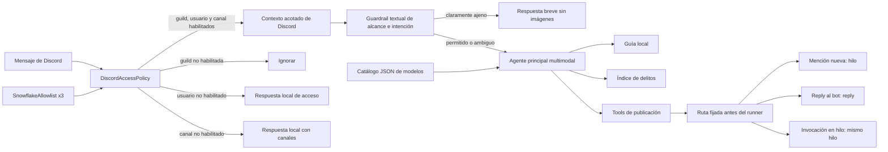

# Arquitectura del MVP

## Flujo

`SnowflakeAllowlist` centraliza el parseo de `DISCORD_GUILD_IDS`, `REVIEW_CHANNEL_IDS` y
`AUTHORIZED_USER_IDS`: ausente, vacío o `*` abre el scope; cualquier CSV lo restringe.
`DiscordAccessPolicy` es el único preprocesador del listener y se ejecuta antes de descargar contexto
o llamar a OpenAI. Valida guild, autor humano, activación por mención o respuesta directa al bot,
usuario y canal padre, en ese orden. Si Discord no incluyó el mensaje referenciado, resuelve solo esa
referencia antes de decidir; una respuesta a cualquier otra persona se ignora. Los rechazos de
usuario o canal usan respuestas locales con cooldown y nunca alcanzan el Runner.

En una redirección por canal, el adaptador resuelve cada ID configurado primero desde la caché de la
guild y confirma los ausentes mediante REST. Solo muestra canales de texto visibles para el bot y el
solicitante. `NotFound` marca el ID como obsoleto durante la vida del proceso; `Forbidden` y errores
temporales producen una orientación sin referencias y un warning estructurado. Esta comprobación es
local a Discord y no consume una ejecución del agente.

Una vez superada la política local, `request_scope` clasifica alcance e intención usando solo el
texto de la solicitud actual y señales compactas de contexto. Es bloqueante
(`run_in_parallel=False`), usa el modelo soportado con `reasoning=none` y no recibe imágenes. Solo
bloquea solicitudes inequívocamente ajenas; saludos, peticiones ambiguas y conversaciones vinculadas
al expediente continúan hacia el agente principal.

Las tools de publicación reciben un `ReviewTarget` derivado del evento aprobado y no aceptan guilds,
canales o mensajes arbitrarios como argumentos. Por ello sus reacciones, hilos y mensajes quedan
acotados al objetivo que atravesó la política. El mensaje raíz es la unidad de exclusión mutua: dos
invocaciones simultáneas para el mismo reporte no generan dos runs.

La política también conserva si la activación fue una mención o una respuesta directa al bot. Una
mención nueva en un canal padre fija la ruta `thread`; un reply al bot en el canal fija
`inline_reply`; dentro de un hilo siempre se usa ese mismo hilo. El modelo no recibe IDs de destino
ni decide esta ruta. El hilo se crea de forma perezosa con la primera publicación, por lo que un
guardrail bloqueado no deja hilos vacíos.

## Capas

- `domain`: modelos Pydantic y enums que definen el contrato de revisión.
- `config`: entorno, allowlists uniformes y catálogo JSON validado de modelo y precios.
- `knowledge`: guía versionada e índice del JSON del PCU, cargados y validados al iniciar.
- `application`: prompt, tools, contexto del runner, errores, tracing y orquestación.
- `infrastructure/discord`: política previa, reconstrucción de hilos, embeds, reacciones y comandos.
- `bootstrap`: composición de dependencias y healthcheck.

## Herramientas del agente

- `get_report_guide(sections)`: devuelve solo las secciones solicitadas.
- `list_charge_index(category_ids, query, fields, match_mode, fuzzy, limit)`: sin filtros lista
  categorías; con filtros busca sobre código, título, tipo, categoría o descripción y retorna IDs y
  resultados compactos. Permite exigir todos/cualquiera de los términos y tolerar typos de forma
  explícita; no acepta expresiones regulares.
- `get_charge_details(charge_ids)`: devuelve hasta diez delitos por ID único.
- `send_message(content)`: mensaje intermedio reutilizable con Markdown de Discord, enlaces y emojis
  moderados; ejecuta el envío de inmediato, pero permite que el agente continúe trabajando.
- `finish_interaction(content)`: envía la respuesta conversacional final y termina explícitamente la
  ejecución; también sirve para devolver el turno al usuario mediante una pregunta aclaratoria.
- `publish_review(publication)`: tool terminal que ejecuta inmediatamente el veredicto en Discord.

`parallel_tool_calls` permanece deshabilitado para mantener un orden determinista en efectos
externos. Solo `finish_interaction` y `publish_review` detienen el runner; `send_message` puede
ejecutarse varias veces antes del cierre. El agente conserva `tool_choice=required` durante todas las
rondas: después de consultar conocimiento o enviar un avance debe escoger una tool siguiente y no
puede finalizar con texto suelto o un mensaje vacío. Las tools locales de conocimiento pueden usarse
también para responder dudas.

## Lifecycle del agente

`ReviewLifecycleHooks` recibe `on_agent_start` después del guardrail bloqueante. Si el preflight
clasificó `review` y existe material revisable, añade `⏳` una sola vez; las conversaciones y las
revisiones sin antecedentes no reciben esa marca. `on_agent_end` registra en contexto el cierre
exitoso. Errores y timeouts permanecen bajo el `try/except` del servicio, porque el hook de término no
se ejecuta cuando el agente no produce una salida final. Así se evita exponer `begin_review` y la
ronda adicional de modelo que requería una tool no terminal.

## Presencia global

`ReviewPresence` asigna una sesión a cada interacción y publica la actividad de mayor prioridad:
`review > knowledge > conversation > idle`. Una sesión solo puede promocionarse, por lo que una
búsqueda de conocimiento no degrada una revisión. Al terminar la actividad prioritaria se recupera
la siguiente que siga activa; el último cierre vuelve a reposo. Solo se llama a Discord cuando cambia
el modo global. `on_ready` resincroniza tras una reconexión y cualquier fallo cosmético se registra
sin interrumpir el expediente. Los cuatro textos se inyectan mediante variables de entorno.

## Resolución del modelo y costos

El entorno selecciona únicamente `OPENAI_MODEL` y `OPENAI_REASONING_EFFORT`. Al arrancar, el runtime
carga `config/data/models.json`, lo valida con Pydantic y rechaza modelos o efforts no soportados. El
catálogo aporta detalle de imagen, verbosity, límite de salida, service tier y tarifas.

El costo se calcula desde `Usage` del Agents SDK. Se conservan los contadores crudos y cada llamada
se tarifa de forma independiente para seleccionar correctamente el tramo de contexto. Las escrituras
de caché tienen su propia tarifa; `reasoning_tokens` es un subconjunto de `output_tokens` y no se suma
por segunda vez. El uso del guardrail se agrega al wrapper del run principal, por lo que sus tokens y
costo quedan incluidos en el total operativo de la solicitud. Si una validación local falla después
de que el Runner terminó, el log conserva el uso completo del resultado en vez de degradarlo al uso
parcial del guardrail.

## Contexto de hilo

No se usan sesiones ni persistencia del SDK. Cada mención reconstruye un input autocontenido con:

- reporte raíz;
- mensajes recientes del hilo en orden cronológico;
- referencias de respuesta y extractos acotados;
- indicador de mensaje editado;
- solicitud actual;
- nombre visible del solicitante y hasta ocho nombres de roles no administrados, ordenados por
  jerarquía y presentados en una sola línea, sin IDs de roles;
- imágenes actuales, imágenes del reporte raíz y hasta dos imágenes históricas recientes.

Los límites de mensajes, caracteres e imágenes se aplican antes del runner. El reporte raíz y la
solicitud actual se protegen al recortar; el resto conserva los mensajes más recientes hasta
`THREAD_CONTEXT_MAX_MESSAGES`. El input indica si el contexto quedó `complete`, `truncated` o
`unavailable` para evitar conclusiones excesivas.

## Extensión futura

`ReviewPublisher` aísla el runner de Discord y las fuentes locales no dependen del bot. Una futura
persistencia puede almacenar configuración, intentos, veredictos y threads sin cambiar el contrato
de `ReviewPublication`. Una API de PCU/OpenMP puede reemplazar `ChargeCatalog` mediante el mismo
interfaz de consulta; una tabla por guild/facción puede sustituir las variables de entorno.
