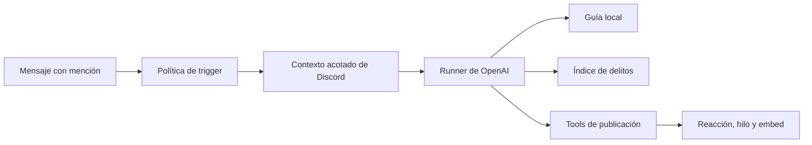

# Arquitectura del MVP

## Flujo

La política de trigger se ejecuta antes de descargar contexto o llamar a OpenAI. El mensaje raíz es
la unidad de exclusión mutua: dos menciones simultáneas para el mismo reporte no generan dos runs.

## Capas

- `domain`: modelos Pydantic y enums que definen el contrato de revisión.
- `knowledge`: guía versionada e índice del JSON del PCU, cargados y validados al iniciar.
- `application`: prompt, tools, contexto del runner, errores, tracing y orquestación.
- `infrastructure/discord`: trigger, reconstrucción de hilos, embeds, reacciones y comandos.
- `bootstrap`: composición de dependencias y healthcheck.

## Herramientas del agente

- `begin_review(case_subject)`: añade `⏳`; no abre hilo.
- `get_report_guide(sections)`: devuelve solo las secciones solicitadas.
- `list_charge_index(category_ids, query, limit)`: sin filtros lista categorías; con filtros retorna
  IDs, códigos y títulos compactos.
- `get_charge_details(charge_ids)`: devuelve hasta diez delitos por ID único.
- `publish_review(publication)`: tool terminal que ejecuta inmediatamente el veredicto en Discord.

`parallel_tool_calls` permanece deshabilitado para mantener un orden determinista en efectos
externos. La publicación terminal impide que el runner continúe generando después de actuar.

## Contexto de hilo

No se usan sesiones ni persistencia del SDK. Cada mención reconstruye un input autocontenido con:

- reporte raíz;
- mensajes recientes del hilo en orden cronológico;
- referencias de respuesta y extractos acotados;
- indicador de mensaje editado;
- solicitud actual;
- imágenes actuales, imágenes del reporte raíz y hasta dos imágenes históricas recientes.

Los límites de mensajes, caracteres e imágenes se aplican antes del runner. El input indica si el
contexto quedó `complete`, `truncated` o `unavailable` para evitar conclusiones excesivas.

## Extensión futura

`ReviewPublisher` aísla el runner de Discord y las fuentes locales no dependen del bot. Una futura
persistencia puede almacenar configuración, intentos, veredictos y threads sin cambiar el contrato
de `ReviewPublication`. Una API de PCU/OpenMP puede reemplazar `ChargeCatalog` mediante el mismo
interfaz de consulta; una tabla por guild/facción puede sustituir las variables de entorno.

