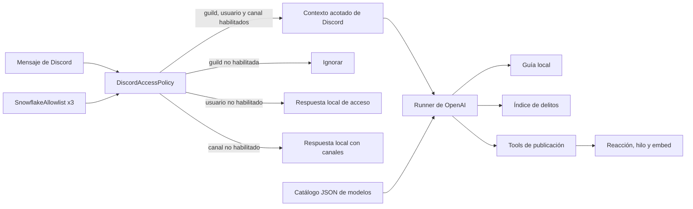

# Arquitectura del MVP

## Flujo

`SnowflakeAllowlist` centraliza el parseo de `DISCORD_GUILD_IDS`, `REVIEW_CHANNEL_IDS` y
`AUTHORIZED_USER_IDS`: ausente, vacío o `*` abre el scope; cualquier CSV lo restringe.
`DiscordAccessPolicy` es el único preprocesador del listener y se ejecuta antes de descargar contexto
o llamar a OpenAI. Valida guild, autor humano, mención explícita, usuario y canal padre, en ese orden.
Los rechazos de usuario o canal usan respuestas locales con cooldown y nunca alcanzan el Runner.

Las tools de publicación reciben un `ReviewTarget` derivado del evento aprobado y no aceptan guilds,
canales o mensajes arbitrarios como argumentos. Por ello sus reacciones, hilos y mensajes quedan
acotados al objetivo que atravesó la política. El mensaje raíz es la unidad de exclusión mutua: dos
menciones simultáneas para el mismo reporte no generan dos runs.

## Capas

- `domain`: modelos Pydantic y enums que definen el contrato de revisión.
- `config`: entorno, allowlists uniformes y catálogo JSON validado de modelo y precios.
- `knowledge`: guía versionada e índice del JSON del PCU, cargados y validados al iniciar.
- `application`: prompt, tools, contexto del runner, errores, tracing y orquestación.
- `infrastructure/discord`: política previa, reconstrucción de hilos, embeds, reacciones y comandos.
- `bootstrap`: composición de dependencias y healthcheck.

## Herramientas del agente

- `begin_review(case_subject)`: añade `⏳`; no abre hilo.
- `get_report_guide(sections)`: devuelve solo las secciones solicitadas.
- `list_charge_index(category_ids, query, limit)`: sin filtros lista categorías; con filtros retorna
  IDs, códigos y títulos compactos.
- `get_charge_details(charge_ids)`: devuelve hasta diez delitos por ID único.
- `publish_review(publication)`: tool terminal que ejecuta inmediatamente el veredicto en Discord.

`parallel_tool_calls` permanece deshabilitado para mantener un orden determinista en efectos
externos. La publicación terminal impide que el runner continúe generando después de actuar.

## Presencia global

`ReviewPresence` mantiene un contador concurrente de revisiones activas. Solo llama a Discord en las
transiciones globales de cero a una revisión y de una a cero; las entradas o salidas intermedias no
pisan la presencia. `on_ready` resincroniza el estado tras una reconexión y cualquier fallo cosmético
se registra sin interrumpir el expediente. Los textos se inyectan desde `BOT_IDLE_ACTIVITY` y
`BOT_BUSY_ACTIVITY`.

## Resolución del modelo y costos

El entorno selecciona únicamente `OPENAI_MODEL` y `OPENAI_REASONING_EFFORT`. Al arrancar, el runtime
carga `config/data/models.json`, lo valida con Pydantic y rechaza modelos o efforts no soportados. El
catálogo aporta detalle de imagen, verbosity, límite de salida, service tier y tarifas.

El costo se calcula desde `Usage` del Agents SDK. Se conservan los contadores crudos y cada llamada
se tarifa de forma independiente para seleccionar correctamente el tramo de contexto. Las escrituras
de caché tienen su propia tarifa; `reasoning_tokens` es un subconjunto de `output_tokens` y no se suma
por segunda vez.

## Contexto de hilo

No se usan sesiones ni persistencia del SDK. Cada mención reconstruye un input autocontenido con:

- reporte raíz;
- mensajes recientes del hilo en orden cronológico;
- referencias de respuesta y extractos acotados;
- indicador de mensaje editado;
- solicitud actual;
- imágenes actuales, imágenes del reporte raíz y hasta dos imágenes históricas recientes.

Los límites de mensajes, caracteres e imágenes se aplican antes del runner. El input indica si el
contexto quedó `complete`, `truncated` o `unavailable` para evitar conclusiones excesivas.

## Extensión futura

`ReviewPublisher` aísla el runner de Discord y las fuentes locales no dependen del bot. Una futura
persistencia puede almacenar configuración, intentos, veredictos y threads sin cambiar el contrato
de `ReviewPublication`. Una API de PCU/OpenMP puede reemplazar `ChargeCatalog` mediante el mismo
interfaz de consulta; una tabla por guild/facción puede sustituir las variables de entorno.
